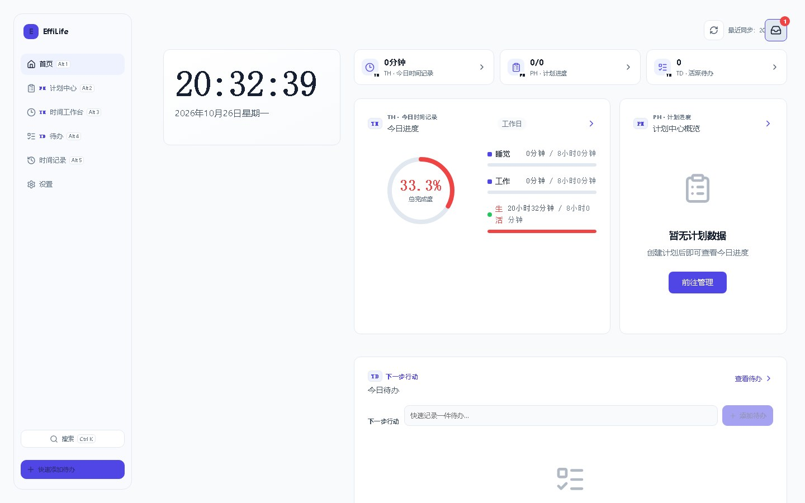
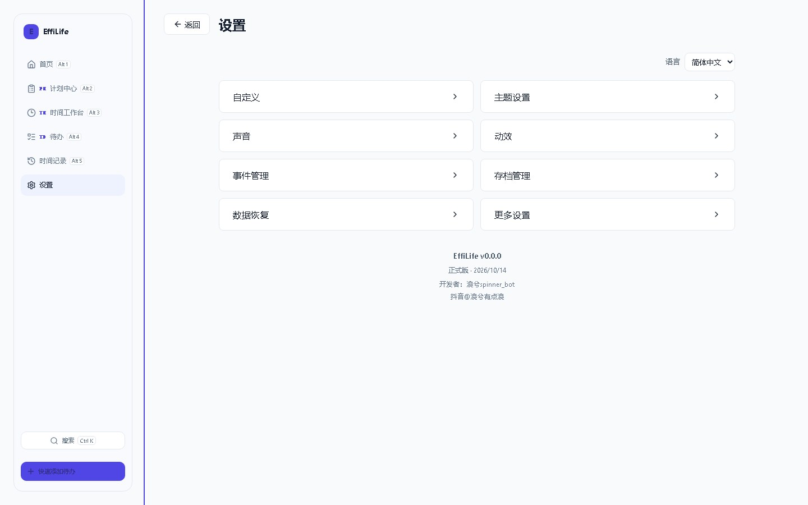

# EffiLife 视觉与产品感审计

- 日期：2026-10-26
- 版本：1.7.0（构建产物日期 2026-10-14）
- 范围：统一工作台桌面端 1440×900、移动端 390×844；浅色/深色；空状态与有数据状态；25 套主题中的基础、暗色与一套装饰主题
- 方式：真实运行生产构建（Vite preview + Plan Helper API），Playwright + Chromium 截图，CDP 读取实际渲染字体与盒模型，不修改业务代码
- 结论性质：产品感与视觉审计，不替代功能验收

> 修订：2026-10-26 v1.2 — 经作者说明，“未记录时间归入背景类别”是切分制的正常计算；P1-4 从“数据造假”改为“默认模式选择不当”，建议系统默认计划全部改为分配制。v1.1：启动补发预警是设计行为，撤回原 P0-4；IndexedDB 问题降级为 P1-11；新增 P1-10 投递状态差异。

## 一、结论

**功能已经很多，但界面还没有形成“一个产品”。** 1285 条测试、恢复链路和发布门禁证明系统不容易坏；但用户第一眼看到的是：字体没有真正生效、控件尺寸与圆角各自为政、计划详情页两块内容叠在一起、记录页版式破碎、版本号显示 `v0.0.0`。

这不是靠继续加功能能解决的。当前最缺的是两样东西：

1. **一个统一的界面层**：字体、字号、间距、圆角、按钮、输入框、空状态都由同一套组件和 token 决定，而不是每个视图自己写 500–1000 行 scoped CSS。
2. **一个视觉验收环节**：现有门禁只验证“能不能用”，不验证“看起来是不是一个产品”。本次审计里的 P0 问题，全部能在 5 分钟内用截图发现，说明流程里缺这一步。

## 二、关键指标

| 指标 | 实测值 | 判断 |
|---|---|---|
| 全量 Python 测试 | 1285 passed（33.96s） | 健康 |
| 启动时间（本地生产构建） | 应用壳就绪 0.52s | 健康 |
| 构建产物 | dist 1.3 MB，无横向溢出 | 健康 |
| 浏览器控制台 | 0 error，427 warning | 有问题（见 P1-11） |
| 实际渲染字体（CDP） | 中文 **Microsoft YaHei**，西文 **Segoe UI**，自定义字体 0 个 | 设计规范未落地 |
| 首页字号分布 | 7/8/9/10/11/12/13/14/16px；**19 个文本 ≤10px** | 过碎、过小 |
| 任务页按钮字号 | 49 个按钮中 **41 个是浏览器默认 13.3333px** | 未继承字体系统 |
| 圆角取值 | 0/5/7/8/9/10/11/12/50%/999px | 未收敛 |
| 移动端可点目标 | 首页 14 个、待办页 15 个 **小于 44×44px** | 触控不合格 |
| 主题数量 | **25 套** | 超出维护与统一能力 |
| 计划详情双栏 | 左栏分配 280px，内容实际 480px | **溢出重叠 200px** |

## 三、P0：直接破坏“专业感”的问题

### P0-1 计划详情页两块内容重叠，进度表单被挤成竖排

- 现象：打开任一计划的详情页，右侧“分组名称/分组说明/添加分组”编辑条压在左侧统计卡上；“记录进展”表单的四个字段被挤成竖排，按钮变形。见 [05-plan-detail.jpg](assets/05-plan-detail.jpg) 与 [05b-plan-detail-overlap.png](assets/05b-plan-detail-overlap.png)。
- 证据（DOM 盒模型）：
  - `.plan-detail-layout` 两列：`280px / 824px`
  - `.plan-detail-aside` 宽度 280px，但其内部 `.plan-detail-summary` 实际宽 480px
  - `.log-editor` 宽 480px，却使用四列 `190px + 39px + 180px + 11px`
  - 结果：左栏内容向右溢出 200px，压住主栏
- 根因：计划详情把“4 字段进度表单 + 4 格统计卡”放进了 280px 的侧栏；`min-width: 0` 只修了外层，没有修内部 grid 的最小内容宽度。同时 `.section-editor` 常驻显示，进一步放大了重叠的视觉冲击。
- 建议：侧栏最小宽度提到 360–400px；进度表单移到主栏或改为两行；`min-width: 0` 下放到内部 grid 子项；窄于 1280px 时直接单栏。顺带把“添加分组”收进按钮，不要常驻一整行表单。

### P0-2 记录页版式破碎，空状态与主操作错位

- 现象：空状态文字居中，但“新增记录”大按钮孤零零在左侧；有记录后，分类名“睡觉”被拆成竖排两行，时长“(44分钟)”断行，整张记录卡只占左侧 550px。见 [07-records-empty.jpg](assets/07-records-empty.jpg)、[08-records-populated.jpg](assets/08-records-populated.jpg)。
- 根因：记录页仍是历史页面结构，没有接入统一列表/空状态组件；卡片内部用固定列宽，中文标签宽度不足时强制换行。
- 建议：用统一 `PageHeader + EmptyState + ListRow` 重写记录页；分类名不换行（`white-space: nowrap` 或图标 + 短名）；空状态与主按钮同一容器。

### P0-3 设置页版本号显示 `v0.0.0`

- 现象：设置页底部与移动端均显示“EffiLife v0.0.0”，而实际版本是 1.7.0。见 [09-settings.jpg](assets/09-settings.jpg)、[13-mobile-settings.jpg](assets/13-mobile-settings.jpg)。
- 根因：`vite-plugins/version-plugin.ts` 在 ESM 配置中用 `require('fs')` 读取 `package.json`，失败后静默返回 `'0.0.0'`。版本号有兜底，但没有失败提示，也没有测试锁住“构建产物版本等于 package 版本”。
- 建议：改用 `fs` 的 ESM 导入或 `import pkg from './package.json'`；构建时版本读取失败应直接失败；增加契约测试读取构建产物中的 `APP_VERSION`。

### P0-4（已撤回）启动时补发预警是设计行为

- 说明：20:33 出现 18:00 的预警，是“软件关闭期间错过触发时间，下次启动补发”的预期逻辑；消息同时进入收件箱并保持未读。本报告初版把它误判为过期弹窗，现更正。
- 仍成立的呈现问题：桌面端弹窗盖住第三张概览卡，移动端盖住整个顶栏与首次引导；文案没有标明这是“补发”（例如“18:00 的预警，现补发”）。
- 建议：保留补发逻辑；补发消息在弹窗上增加原定时间与“补发”标识；移动端将弹窗放到顶栏下方；同一时刻只展示一条，其余归入收件箱。
- 投递状态的设计差异见 P1-10。

### P0-5 `npm run dev` / 统一启动器在本机无法稳定启动

- 现象：Vite 监听 `src-tauri/target` 时对 Rust 构建产物执行 `lstat` 失败（`UNKNOWN: unknown error`），开发服务器退出；统一启动器等待 30 秒后报“服务未响应”，随即退出。本次审计只能用 `vite preview` 跑生产构建。
- 证据：`launcher.log` 中 `service_start_failed`；Vite stderr 指向 `src-tauri/target/debug/build/proc-macro2-*/build-script-build.exe`。
- 影响：开发者体验与“专业度”直接挂钩；启动器文档说“READY”，实际跑不起来。
- 建议：`server.watch.ignored` 排除 `src-tauri/**`（或至少 `**/target/**`）；启动器把 30 秒超时改为可诊断的失败并输出 Vite stderr 首因。

## 四、P1：系统性的不一致

### P1-1 字体系统从未真正生效

- 设计规范要求 Inter / Noto Sans SC / JetBrains Mono；仓库没有字体文件、没有 `@font-face`、没有字体依赖。
- CDP 实测：正文中文 **Microsoft YaHei**，西文 **Segoe UI**，`isCustomFont=false`，`document.fonts.size=0`。
- 后果：字重、字距、数字对齐与设计稿完全不同；“克制、精致”的基准从第一屏就不存在。
- 建议：内置 Inter 可变字体 + Noto Sans SC 子集（或明确宣布使用系统字体并重写规范）；建立 8 级字号表，正文最小 13–14px，任何常驻文本不小于 12px。

### P1-2 每个页面自己发明控件

- 12 个视图 15,316 行，其中约 **6,300 行是各页面私有 scoped CSS**；共享组件只有 12 个、1,524 行。
- 任务页 41/49 个按钮没有继承字体，回落到浏览器默认 13.3333px；圆角出现 0/5/7/8/9/10/11/12/50%/999px 十种取值；按钮高度 31–64px。
- 建议：抽出 Button / Input / Select / Card / Dialog / Tabs / PageHeader / EmptyState 八个基础组件；页面只允许组合，不再写按钮外观。

### P1-3 导航与命名：同一个东西有三个名字

- 左侧导航：首页 / 计划中心 / 时间工作台 / 待办 / 时间记录 / 设置
- 页内又出现一排：时间工作台 / 计划中心 / 待办
- 页面标题：计划工作台 / 记录管理 / 待办中心
- 模块代码 TH / PH / TD 以 9–10px 徽标出现在导航、卡片、引导文案里。
- 建议：全站只保留一套导航；统一命名（例如 计划 / 时间 / 待办 / 记录 / 设置）；模块代码只出现在开发者信息里，不进入用户主界面。

### P1-4 首次启动默认进入切分制，背景类别把“未记录”算成 33%

- 现象：在没有任何时间记录、计划、待办的首页，时间卡显示 **33.3% 完成度**、**20 小时 33 分“生活”**，以及一条满格红色进度条；同屏的 TH/PH/TD 概览却都是 0。见 [02-home-empty.jpg](assets/02-home-empty.jpg)。
- 这是正确逻辑，不是数据造假：切分制会把未被记录的时间自动归入背景类别；“工作日”默认背景类别为“生活”，时限 8 小时，超出部分不计入，因此当天无记录时进度为 8/24 ≈ 33%。本报告初版把它当成空状态缺陷，现更正。
- 产品问题在于默认选择：当前 `DEFAULT_PLANS` 的“工作日”和“吃了就睡”都是切分制，默认日计划、`resolvePlan` 与 `getDayPlan` 的兜底也都回落到切分制，于是新用户第一次打开就得到一个反直觉的非零进度。
- 建议：保留切分制能力，但把分配制作为系统默认——所有内置计划、默认日计划与兜底值改为分配制；切分制只在用户主动选择时启用，并在首次选择时说明背景类别的含义。旧用户已保存的计划不静默迁移，另给“切换为分配制”的显式入口。
- 注意：`tests/test_plan_runtime_fallback.py` 目前直接断言兜底字符串 `'切分制'`，改默认值时需要同步更新该契约测试。

### P1-5 首页布局失衡、标签与状态互相遮挡

- 时钟卡独占左列，下方整片空白；顶栏“最近同步：20…”被右上角收件箱按钮压住；分类名“生活”被拆成两行。
- 建议：三栏或两栏重新分配；顶栏状态与收件箱放到同一 flex 容器；分类名不换行。

### P1-6 待办行控件过载

- 5 条待办对应 49 个按钮、17 个输入；每行同时有勾选框、优先级圆点、“默认”标签、子任务数、筛选、编辑、删除。
- 建议：每行只保留勾选 + 标题 + 截止日期；其余进悬浮菜单；左侧筛选区收进一个筛选按钮。

### P1-7 25 套主题与“克制”的设计目标相反

- 主题画廊是一堵相同的白卡；选中装饰主题（如赛博朋克）后，霓虹底色、网格背景与原有控件风格互相打架。见 [10-theme-gallery.jpg](assets/10-theme-gallery.jpg)、[15-home-cyberpunk.jpg](assets/15-home-cyberpunk.jpg)。
- 建议：正式版只保留 3–5 套经过验收的主题（浅色/深色/跟随系统 + 至多 2 套风格化）；其余标记“实验性”并隐藏；主题卡改为真实缩略预览。

### P1-8 移动端：顶栏拥挤、悬浮按钮遮挡内容、触控目标过小

- 顶栏 logo 被裁、搜索与快速添加挤在一行；悬浮 `+` 压在设置页页脚和待办空状态图标上；首页/待办页分别有 14/15 个小于 44×44px 的可点元素；底部导航 6 项标签只有 10px。见 [12-mobile-home.jpg](assets/12-mobile-home.jpg)、[13-mobile-settings.jpg](assets/13-mobile-settings.jpg)。
- 建议：顶栏只保留 1 个主操作；FAB 与底部导航合并；所有可点元素 ≥44px；底部导航最多 5 项，标签 ≥11px。

### P1-9 文案里混入开发语言

- “整份计划 · PH”“本地计划快照”“TH 时间记录、PH 整份计划、TD 单条待办”“Alt 1”等到处出现。
- 建议：面向用户的文案不出现模块缩写与内部实现词；快捷键提示只出现在帮助中心或悬停提示里。

### P1-10 补发去重依据是“规则当天已触发”，不是“消息已投递”

- 现状：`checkWarnings()` 用 `dailyTriggers` 的 `warning_<ruleId>_<date>` 去重；消息生成后立即写入该标记。`WarningRecord` 只有 `dismissed`，没有 delivered/unread 的投递状态，`getWarningInbox()` 也没有启动时重放入口。
- 后果：如果消息已经生成、但弹窗因“启动后立即关闭”或渲染失败而从未真正展示，下次启动不会补发；收件箱里能看到未读，但不会再次弹出。这与“未发出 → 下一次启动补发”的目标语义不完全一致。
- 建议：给 `WarningRecord` / `InboxEntry` 增加 `deliveryState`（pending / delivered / read）；启动时重放 pending；弹窗真正展示后再标记 delivered；已投递但未读的只进收件箱，不重复弹窗。

### P1-11 IndexedDB 镜像写入失败（原报告 P0-5）

- 证据：单次审计产生 **427 条 warning**，其中：
  - `Failed to hydrate audio settings: DataCloneError` ×20
  - `Failed to hydrate event data: DataCloneError` ×18
  - `Failed to persist warning inbox` ×2、`Failed to persist event inbox` ×2
  - 其余 385 条为 AudioContext 未获用户手势（正常但噪声大）
- 影响：localStorage 仍在写入，本次没有观察到设置直接丢失；但 IndexedDB 镜像保持缺失或陈旧，存档导出/导入、跨窗口刷新与“补发投递状态”都可能读到旧数据。控制台长期 427 条 warning 也会掩盖真正的问题。
- 根因（高度可疑）：把 Vue 响应式 Proxy 直接 `put` 进 IndexedDB，结构化克隆失败。需要深拷贝/`toRaw`/JSON 序列化后再写。
- 建议：统一存储写入层做可克隆化处理；失败时进入可见的错误状态而不是仅 `console.warn`；增加真实 IndexedDB 写入测试。

## 五、P2：打磨项

- 对比度：品牌标记与“快速添加待办”按钮为深靛蓝文字配靛蓝底（约 1.82:1）；收件箱数字徽标 3.76:1；深色主题模块代码 4.35:1。均低于 4.5:1。
- 首页没有 `h1`，标题层级从 `h2` 开始；移动端也有同样问题。
- 5 条待办快速创建时，5 个“待办已添加”Toast 同时堆叠并遮住列表。脚本创建会放大这一现象，但 Toast 缺少合并/限流是事实。
- 侧栏导航项高度 38px，低于 44px 的桌面触控建议值（鼠标场景可接受）。

## 六、做得好的部分

- 功能链路真实可用：计划创建、待办增删改、时间记录、深色切换、主题选择、移动端引导都能走通。
- 无页面级异常，无横向溢出；焦点样式、`prefers-reduced-motion`、skip link、aria 标签、确认弹窗焦点陷阱都有。
- 构建体积 1.3MB、启动 0.52s，性能不是当前短板。
- 测试体系、恢复链路与发布门禁是资产，应保留；问题在于它们没有覆盖“看起来怎样”。

## 七、建议的收口顺序

**第一周：先修 P0 + 排版地基**

1. 计划详情布局（P0-1）、记录页（P0-2）、版本号（P0-3）——三个都是小范围改动，收益最大。
2. IndexedDB 镜像写入与补发投递状态（P1-10、P1-11）——各半天到一天。
3. 开发服务器监听（P0-5）——让 `npm run dev`/启动器恢复可用。
4. 字体真正加载 + 字号表（P1-1），把 7–10px 文本全部清掉。

**第二周：统一界面层**

5. 八个基础组件 + 首页/计划/待办/记录四页重写，删除它们的私有 CSS。
6. 一套导航与命名；设置合并为一页分区；主题收敛到 3–5 套。
7. 默认模式改为分配制：内置计划、默认日计划、`resolvePlan`/`getDayPlan` 兜底全部改分配制，切分制改为显式选择；同步更新 `test_plan_runtime_fallback.py` 的默认值断言。
8. 移动端顶栏/FAB/底部导航重排。
9. 把本次审计脚本扩展成 6 路由 × 2 视口的截图回归，纳入发布候选门禁。

**不要现在做的事**：继续增加主题、增加设置入口、增加门禁条目、为每个小修复写一份新报告。先把“一个产品”立住。

## 八、审计局限

- 只覆盖 Chromium 桌面与移动视口，未做 Windows 安装包内 WebView、Android 真机、屏幕阅读器与全主题人工视觉验收。
- 未运行真实用户数据量级（大型 `.efl`、数百条记录）下的版式压力测试。
- 生产构建取自 2026-10-14 的 `dist`，与当前 `main` 代码同一天；P0-1 已在源码与盒模型两侧交叉确认。
- 本次审计未修改任何业务代码；原始截图与 JSON 指标保留在本机 `.tmp/audit/`，入库的是精选证据。

## 附录：证据索引

| 截图 | 内容 |
|---|---|
| [01-home-first-paint.jpg](assets/01-home-first-paint.jpg) | 启动补发预警（设计行为）在桌面端遮挡概览卡 |
| [02-home-empty.jpg](assets/02-home-empty.jpg) | 切分制背景类别导致首次启动显示 33.3%（逻辑正确，默认模式不当） |
| [03-home-populated.jpg](assets/03-home-populated.jpg) | 有数据首页 |
| [04-plans-empty.jpg](assets/04-plans-empty.jpg) | 计划中心空状态 |
| [05-plan-detail.jpg](assets/05-plan-detail.jpg) | 计划详情重叠 |
| [05b-plan-detail-overlap.png](assets/05b-plan-detail-overlap.png) | 重叠区域放大 |
| [06-tasks-populated.jpg](assets/06-tasks-populated.jpg) | 待办行控件过载、Toast 堆叠 |
| [07-records-empty.jpg](assets/07-records-empty.jpg) | 记录页空状态错位 |
| [08-records-populated.jpg](assets/08-records-populated.jpg) | 记录卡竖排与断行 |
| [09-settings.jpg](assets/09-settings.jpg) | 设置页与 `v0.0.0` |
| [10-theme-gallery.jpg](assets/10-theme-gallery.jpg) | 25 套主题画廊 |
| [11-home-dark.jpg](assets/11-home-dark.jpg) | 深色主题 |
| [12-mobile-home.jpg](assets/12-mobile-home.jpg) | 移动端首页 |
| [13-mobile-settings.jpg](assets/13-mobile-settings.jpg) | 移动端设置与页脚遮挡 |
| [14-mobile-onboarding.jpg](assets/14-mobile-onboarding.jpg) | 移动端补发预警与首次引导重叠（呈现问题） |
| [15-home-cyberpunk.jpg](assets/15-home-cyberpunk.jpg) | 装饰主题下的全站视觉 |
