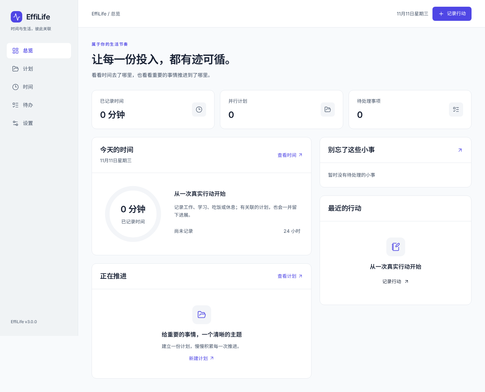
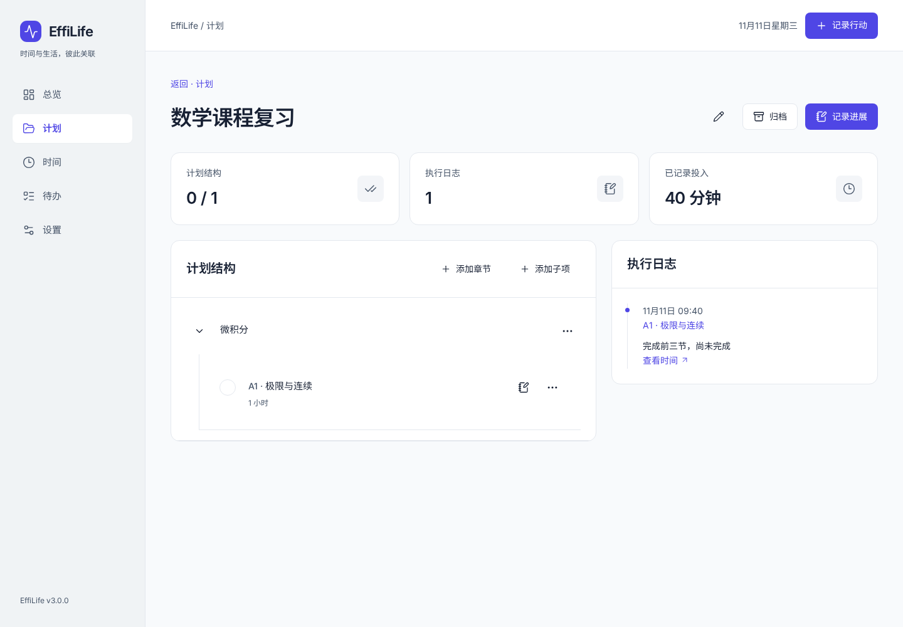
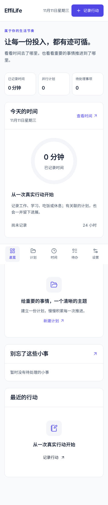

# 0003 — 应用壳与基础产品动线

- 日期：2026-11-11
- 作者：Codex  (sqs_A100)
- 产品版本：3.0.0（开发中）

## 已实现

共享 token、信息组件、Reka 对话框与菜单组成应用壳。总览展示真实记录和并行计划；计划支持层级、父节点类别设置、进展日志与归档；时间页查看和编辑实际记录；待办支持快速收集、优先分、编辑和完成；设置集中管理语言、字体、配色、类别与存档恢复。

统一录入同时处理时间和计划进展，支持单独记录未完成日志；时间记录和计划日志可以互相定位。修改同一次行动的描述会同步关联展示。

内置字体实际由本地资源加载。25 套旧主题已迁入资源目录并提供配色切换，原装饰源码保留；主题包权限及装饰运行时尚未完成。

## 验证与修复

- 7 个单元测试文件，43 项通过；包括字段级跨视图编辑与混合层级编号回归。
- 生产构建、严格类型检查与版本检查通过。
- 7 项真实 Chromium 浏览器测试通过，测试过程未观察到应用控制台 error/warning。
- 覆盖真实空状态与字体、计划/子项/类别/未完成日志/实际时间/刷新/关联导航、纯进展日志、待办完成与重开、语言/主题持久化、导出/预览导入/恢复。
- 五个基础页面的空状态/设置页面在 320、390、768、1024、1280、1440、1920 宽度下无页面横向溢出；尚未完成所有有数据布局的全矩阵审计。
- 已修复真实浏览器发现的导入响应式 Proxy 克隆失败，并在应用服务边界规范化传入快照。
- 已修复移动端信息面板收缩和旧主题部分配色的文字对比度问题。

## 视觉证据

## 环境

匹配的 Playwright Headless Shell 下载与运行依赖位于 v3/.cache/、v3/.tools/；缺失的 libasound2 仅解包到本地目录，未修改服务器系统安装包。浏览器安装支持分段续传和归档 CRC 校验。

## 后续工作

继续时间分配规则、其他旧数据字段迁移、扩展包与权限运行时、交互和有数据布局的深入回归，以及原生桌面构建交付。当前不是最终发布验收。
