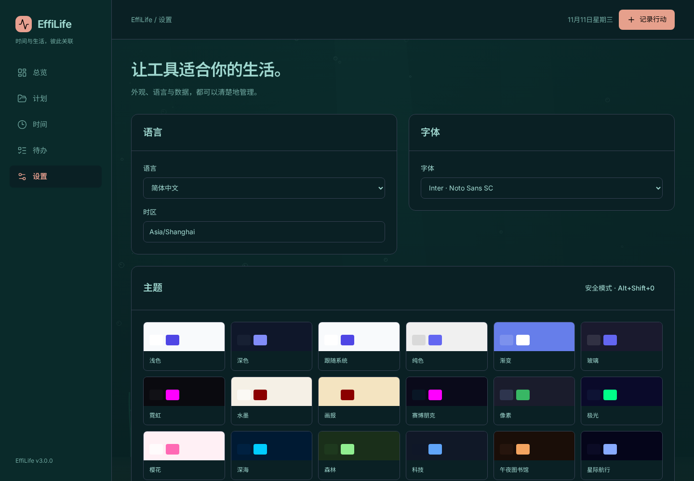

# 0006 — 隔离脚本、应用接口与恢复

- 日期：2026-11-11
- 作者：Codex  (sqs_A100)
- 产品版本：3.0.0（开发中）

## 运行时边界

包代码仅在 Worker 中执行。受信任 iframe 中继持有 OffscreenCanvas、受控 HTML/CSS 容器和专用 MessageChannel；iframe 的 sandbox 仅允许 scripts，不共享来源。CSP 默认拒绝资源与网络，只允许带 nonce 的中继代码、样式及其 blob Worker。包源代码通过通道传入，不拼接进 iframe HTML。

L2 绘制使用 Worker 回调，最多 30 FPS；不可见时暂停，减少动态效果时保留静态帧。交互装饰可以接收位置事件。L3 使用任意几何排布的隔离 HTML/CSS：过滤执行标签、URL、事件属性和导航资源元素，应用 DOM 不向包开放。主题可替换界面，功能包拥有可滚动堆叠的独立卡片。

受控 data/settings/theme/navigation API 逐项检查当前启用状态、包内容指纹与授权。读生活数据不返回注册表、收据或审计；数据写入不能转成安装、授权或恢复指令。设置修改与主题控制分别授权。写入在领域事务中再次裁决权限，避免读取许可后撤销的竞态；写入审计与实际数据原子提交，传输重试去重。

## 保留与恢复

全部 25 套内置配色和既有装饰保留；复古花朵辅助函数、四套复杂场景的粒子初始化闭包由迁移脚本保留到资源，再在 Worker 中初始化。浏览器逐套执行验证，而非只保留函数字符串。

恢复控件不处于扩展 CSS 或 iframe 内；替换脚本尚未就绪时也可使用。Alt+Shift+0 / ?safe=1 可跳过全部扩展加载，并保留原状态供检查。确认恢复默认后才停用扩展并重置外观、字体与语言；生活数据不删除。脚本超时或洪泛会停止，失败状态写入注册表与审计，刷新不会反复重启。

修复真实测试暴露的授权二次确认被预览遮挡：模态层级按打开顺序计算，避免 Teleport 的源码顺序与路由延迟加载互相干扰。

## 验证证据

- 12 个单元测试文件、72 项通过；新增数据视图排除权限数据、原子写入/审计与去重、撤销竞态、版本指纹、设置与主题权限隔离、递归包装与注册表提权拒绝。
- 17 项真实 Chromium 浏览器测试通过；生产构建、严格类型与版本门禁通过。
- 25 套主题逐套切换，有装饰的主题均完成不透明 iframe 与 Worker ready 握手。
- L3 界面真实读取、写入计划并恢复默认界面；未获授权写入明确拒绝且没有新增计划。
- 无限循环脚本未阻塞宿主，15 秒心跳门限后停止，刷新后仍为失败状态。
- 验证 Worker 无直接 document/存储/网络入口；从原型恢复原生 fetch 的攻击路径仍被 CSP 阻止，受控网络探针没有收到请求。
- 验证 iframe 访问 parent.document、localStorage 与 IndexedDB 均抛 SecurityError；危险 HTML 资源元素被移除。
- URL 安全模式不执行已启用的扩展，恢复操作停用扩展并退出安全模式。
- 正常产品动线控制台未观察到 error/warning；网络阻断测试仅允许并明确断言预期的 CSP 阻止消息，其他控制台错误仍失败。
- 示例主题、语言与功能包构建成功，源码和 HTML API 指南见 ../extension-authoring.html。

## 实际限制与后续

当前证据来自 Chromium，不代表所有原生 WebView 已验收。Worker 无严格的每实例内存配额；帧率、心跳、报文大小与频率限制不能等同于操作系统进程沙箱。原生桌面构建、跨平台运行与持续大数据压力验证继续推进。随后补齐旧字段的可操作迁移和深入交互验收。

实现依据：[CSP 与 blob Worker 策略继承](https://developer.mozilla.org/en-US/docs/Web/HTTP/Reference/Headers/Content-Security-Policy)、[不透明来源](https://developer.mozilla.org/en-US/docs/Web/HTTP/Reference/Headers/Content-Security-Policy/sandbox)、[OffscreenCanvas](https://developer.mozilla.org/en-US/docs/Web/API/HTMLCanvasElement/transferControlToOffscreen)。这些文档支持边界设计，实际支持情况以上述浏览器试验为准。

