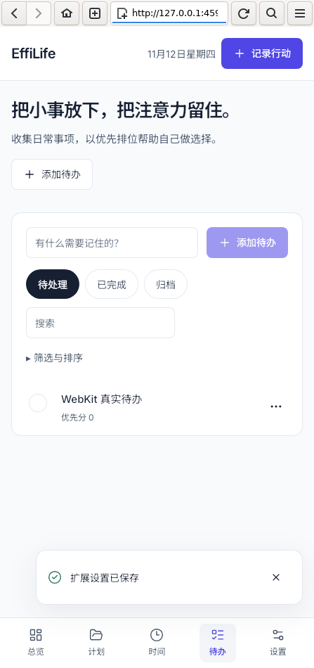

# 0008 — 统一录入与第二引擎验收

- 日期：2026-11-12
- 作者：Codex  (sqs_A100)
- 产品版本：3.0.0（开发中）

## 时间与事项关联

统一入口可选择计划或独立待办。待办行中的“记录本次用时”打开相同录入界面，继承事项名称和类别，可同时完成待办；实际记录与事项互相定位。删除待办保留真实用时，只清理关联。旧版待办的双向时间引用按明确来源归并，冲突给出警告并保留原始输入。

用时参考按用户选择的行动时刻寻找最近观测，补录过去的行动不会使用当前墙钟推算。重复事项补录完成时保留真实完成时刻，但下次安排从当前时间计算，不创建已经过去的下一实例。

整个 Plan 现在也可以设置时间类别。默认保留下方显式设置；勾选覆盖则统一所有后代。新增根条目、计划整体的行动及统一入口选择计划均使用此默认值。设置只影响之后的记录，已有真实记录不随组织类别改变。

## 提交确认与兼容

存档替换及备份恢复直接返回已提交快照，界面不再依赖一次额外读取来确认成功。主记录损坏时保留已知备份的递增修订号。资源包启动兼容性以实际应用版本校验，不能借导入数据的版本字段绕过。键盘跳过导航保留当前 hash 路由和查询参数。

## 验证证据

- 13 个单元测试文件、87 项通过；生产构建、严格类型和版本检查通过。
- 23 项真实 Chromium 浏览器测试通过，新增独立待办用时、实际区间确认、事项完成与删除历史保留、整份计划类别继承和键盘跳转。
- Linux WebKitGTK 2.50.4 的真实生产界面完成 8 项检查：启动、IndexedDB 保存与刷新、装饰 Worker/OffscreenCanvas、真实包上传及高级授权、不透明来源 DOM/存储隔离、原始 fetch 恢复后的 CSP 阻断、布局恢复、390px 布局。
- [WebKit 原始结果](assets/0008-webkit-result.json)记录 0 次网络探针请求和 0px 横向溢出。

## 桌面交付状态

已建立独立身份 com.effilife.desktop.v3 的 Tauri 宿主、选择路径后写文件的适配和能力声明，Cargo.lock 固定原生依赖。Rust 1.99.1 与本地 SDK 成功编译 effilife-desktop 的 debug 应用。原生宿主的真实窗口、系统文件保存和安装包验收继续推进，本阶段不将编译通过视为桌面完整运行通过。

SDK 仅解包于 v3/.tools；PRoot 在测试进程内映射 WebKit 编译时的子进程路径，不写系统 /usr。服务器以 root 运行，因此测试进程显式关闭 WebKit 的 Linux 进程沙箱；这里验证的是应用扩展隔离及 WebKit 行为，不是操作系统沙箱认证。Windows、macOS 及移动系统尚未实测。

复现入口：`python3 v3/scripts/run.py npm run verify`；之后运行 `python3 v3/tests/native/webkit_smoke.py`。后者需要已准备的本地 Linux SDK，并在生产 dist 上运行。
