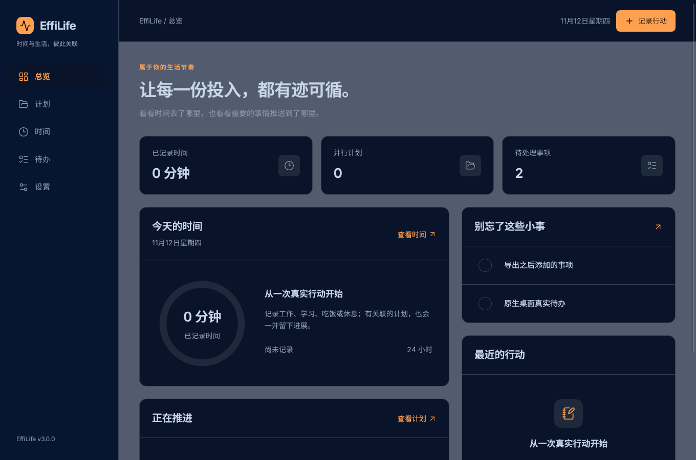
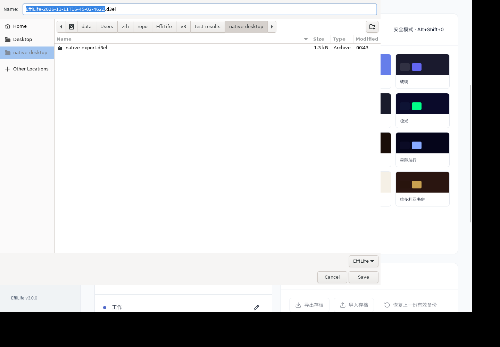

# 0009 — 原生桌面与长期历史验收

- 日期：2026-11-12
- 作者：Codex  (sqs_A100)
- 产品版本：3.0.0（开发中）

## 真实桌面程序

Rust 1.99.1、Tauri 2.12.5、GTK 3.24.33、WebKitGTK 2.50.4 完成 release 构建与 Debian amd64 包生成。包为 `EffiLife_3.0.0_amd64.deb`，9,211,374 字节；版本、架构、系统依赖及桌面入口已检查。

对该包执行 dpkg-deb 解包，将实际包内的 `usr/bin/effilife-desktop` 交给固定的 tauri-driver 2.1.0 驱动，10 项检查全部通过：真实 Tauri 启动、安全原生来源与 UUID、IndexedDB 保存刷新、未选路径写入拒绝、系统 GTK 保存对话框及选定路径写入、导出数据与 SHA-256、文件导入、有效备份恢复、主题 Worker、关闭并重新启动程序后的数据保留。

- [原生结果与实际程序指纹](assets/0009-desktop-result.json)
- [生产 WebKitGTK 结果与前端指纹](assets/0009-webkit-result.json)
- 安装包 SHA-256：`90867c0210eeb3fdd8e966c5918a1e32b6bf7d4253ac55b96d17ab875835ea50`
- 包内程序 SHA-256：`ed4c517bfbb58bd17b55711654dc51535da6e639120ac3690379f518a2cf2c9c`

## 测试环境边界

SDK 从 APT 下载并校验后仅解包至 v3/.tools。PRoot 下 GTK 文件系统查询出现 Bad address，无法可靠使用文件选择器；桌面测试改用一个仅重定位三个 WebKit 子进程可执行路径的 LD_PRELOAD 适配，不拦截文件、IPC 或应用逻辑。正常安装到系统中的应用使用发行版自己的 WebKit 路径，不需要此测试适配。

原生测试在独立 XDG 数据目录、Xvfb 和 CPU 渲染路径运行。root 测试进程关闭 WebKit 的 Linux 进程沙箱，因此不能将这些结果视作操作系统沙箱认证。这里没有对工作站执行系统安装、卸载或软件包注册；验证的是包结构和真实包内程序，不是目标机安装器操作。其他操作系统尚未实测。

## 长期记录开销

新增 15,000 条实际记录、对应计划日志和待办关联的完整性场景，检查有效历史以及末尾损坏引用。把反复扫描改为引用索引后，同一测试序列由约 4.47 秒降至 0.31 秒；仍拒绝损坏关联。这是本机测试结果，不是对所有设备或任意数据规模的性能承诺。

## 完整回归与文档

- 14 个单元测试文件、88 项通过；类型检查、版本门禁和生产构建通过。
- 23 项真实 Chromium 浏览器测试通过。
- 最终生产 dist 的真实 WebKitGTK 8 项检查通过，0 次网络探针请求，390px 界面无横向溢出。
- 新增 [HTML 使用与验收指南](../user-guide.html)，覆盖统一录入、未完成日志、类别继承、时间分配、重复待办、迁移备份和扩展恢复。文档附本地中文字体及原 OFL；390px 检查无横向溢出。

## 交付收尾

原生编译与真实运行链路已完成。下一步整理可校验的验收交付目录、前端预览产物和示例包，保留实际测试指纹，避免把未经验证或已经改变的二进制混入交付。
